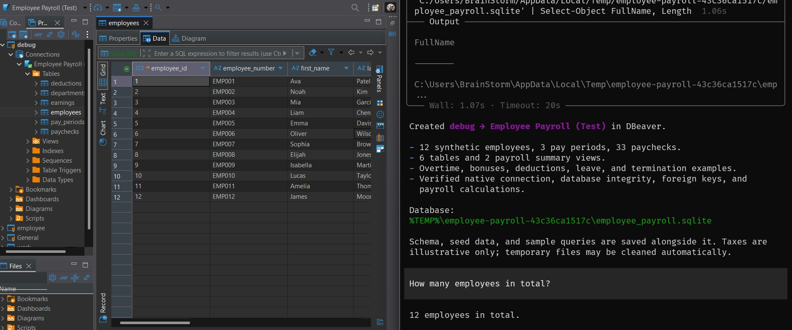

# DBeaver data export plugin

A ja-netfilter plugin that exposes a local HTTP API inside
the running DBeaver JVM. It supports project and driver discovery, connection
creation/inspection/editing/testing, schema and row reads, SQL execution, and
explicitly authorized Java runtime evaluation. It is not a standalone server.

See the bundled [operator guide](skills/dbeaver-database-operator/SKILL.md) for
connection workflows and the [API reference](skills/dbeaver-database-operator/references/api.md)
for request, response, and error contracts.



## Requirements

- JDK 17 or newer for the build. DBeaver itself may require a newer Java version.
  Set `JAVA_HOME` to the JDK directory, not its `bin/` directory or `java.exe`.
- For `/runtime/evaluate`, the JVM **running DBeaver** must include the Java
  compiler (`jdk.compiler`). A JDK used only by Maven does not satisfy this.
- The ja-netfilter core and the vendor dependencies listed below.
- Maven installed with `mvn` available on `PATH`.
- Python 3 for the bundled API client; no third-party Python packages are needed.

Commands below use **Bash** (including Git Bash on Windows), except the Windows
batch example in the agent-installation section. Start in this repository's
root and replace example absolute paths with your own. In Git Bash,
`C:\path\to\jdk` is `/c/path/to/jdk`; on Linux/macOS use the native JDK path.

Select your installed JDK for the current Bash session and check Maven before
building:

```bash
export JAVA_HOME="/path/to/jdk"
mvn --version
```

## Build

### 1. Install the ja-netfilter core

The default layout has independent sibling repositories:

```text
workspace/
  ja-netfilter/
  dbeaver-data-export-plugin/
```

Build and install the core into your local Maven repository:

```bash
mvn -f /path/to/ja-netfilter/pom.xml install
```

### 2. Install matching vendor JARs

The current [pom.xml](pom.xml) requires these locally supplied artifacts:

| Maven coordinates | Source |
|---|---|
| `com.ja-netfilter:ja-netfilter:2025.3.0` | Core build above |
| `com.dbeaver.lm:com.dbeaver.lm.api:3.0.9` | Matching DBeaver installation's `plugins/` |
| `org.jkiss:org.jkiss.utils:2.4.0` | Matching DBeaver installation's `plugins/` |

DBeaver bundle filenames usually include a version and build qualifier. Select
JARs whose bundle versions match the dependency versions above. Do **not**
install an arbitrary newer JAR under an older Maven version. For example,
`3.0.35` is not `3.0.9`, and `2.7.0` is not `2.4.0`. Using newer dependencies
requires a deliberate POM update and compatibility verification.

Set these paths to the matching JARs you obtained, then install them:

```bash
lm_api_jar="/path/to/matching/com.dbeaver.lm.api.jar"
utils_jar="/path/to/matching/org.jkiss.utils.jar"

mvn install:install-file \
  "-Dfile=$lm_api_jar" \
  -DgroupId=com.dbeaver.lm \
  -DartifactId=com.dbeaver.lm.api \
  -Dversion=3.0.9 \
  -Dpackaging=jar \
  -DgeneratePom=true

mvn install:install-file \
  "-Dfile=$utils_jar" \
  -DgroupId=org.jkiss \
  -DartifactId=org.jkiss.utils \
  -Dversion=2.4.0 \
  -Dpackaging=jar \
  -DgeneratePom=true
```

### 3. Package the plugin

```bash
mvn package
```

This runs the tests and creates:

| Output under `target/` | Purpose |
|---|---|
| `dbeaver-data-export-plugin-1.0.0.jar` | Shaded plugin JAR to deploy |
| `original-dbeaver-data-export-plugin-1.0.0.jar` | Unshaded intermediate; do not deploy |

Packaging does not copy the plugin into the agent runtime or restart DBeaver.

## Deploy and start DBeaver

Close the DBeaver instance using this agent before replacing its deployed JAR.
For the default sibling layout:

```bash
agent_home="/path/to/ja-netfilter/target"
mkdir -p "$agent_home/plugins"
cp ./target/dbeaver-data-export-plugin-1.0.0.jar "$agent_home/plugins/"
```

The plugin belongs in **`plugins/` beside the agent JAR**, not directly in
`target/`. Keep only one enabled copy of this plugin there. If the agent uses
an application argument such as `-javaagent:...\agent.jar=myapp`, its directory
is `plugins-myapp/` instead.

Add these JVM options to the existing **`-vmargs` section** of `dbeaver.ini`.
Preserve its other options; do not add a second `-vmargs` section. Use an
absolute agent path rather than depending on DBeaver's working directory:
The following Windows example uses a native filesystem path, not Git Bash's
`/c/...` notation.

```text
-vmargs
-javaagent:C:\path\to\ja-netfilter\target\ja-netfilter-jar-with-dependencies.jar
-Djanf.dataExport.port=8765
```

The agent JAR above loads the separate plugin JAR. Restart DBeaver after each
deployment; there is no automatic plugin hot reload. The API starts after the
plugin captures DBeaver's runtime classloader. Its startup message is:

```text
[dbeaver-data-export] HTTP on http://127.0.0.1:8765
```

Check discovery with the bundled client:

```bash
db_api="./skills/dbeaver-database-operator/scripts/dbeaver_api.py"
python3 "$db_api" projects
```

The default URL is `http://127.0.0.1:8765`. If you change the JVM port property,
set the client's `--base-url` or `DBEAVER_DATA_API_URL` to match. Configure
credentials and unlock protected projects through DBeaver's native UI.

## Debug with IntelliJ IDEA

Add this option after `-vmargs`, before the existing `-javaagent` line:

```text
-agentlib:jdwp=transport=dt_socket,server=y,suspend=y,address=127.0.0.1:5006
```

In **Run → Edit Configurations → Add → Remote JVM Debug**:

| Setting | Value |
|---|---|
| Debugger mode | Attach to remote JVM |
| Host | `127.0.0.1` |
| Port | `5006` |
| Module classpath | The imported plugin module |

Set breakpoints, launch DBeaver, then attach IDEA and resume execution.
`suspend=y` pauses startup until attachment, so the GUI will not open yet.
Use it when debugging startup code such as `DataExportPlugin.init`; attaching
later with `suspend=n` can miss that code. The HTTP port `8765` and debugger
port `5006` are separate.

## JVM runtime evaluation

**Trust boundary:** the API has no plugin-managed authentication or token.
It binds to `127.0.0.1`, but loopback binding and `Origin` rejection are not
authentication. A local process that can reach `/runtime/evaluate` can run
arbitrary Java with the DBeaver process's privileges. There is no sandbox or
credential isolation. External protection must cover direct listener access.

Run snippets only with explicit authorization. `code` is a Java 17 **method
body**, not a class or import block. Optional `args` is a JSON object. This
endpoint does not require a project or datasource selector.

Save this UTF-8 JSON as `runtime-request.json`:

```json
{
  "code": "System.out.println(\"Hello, world!\"); return \"Hello, world!\";"
}
```

Invoke it once with the bundled client:

```bash
db_api="./skills/dbeaver-database-operator/scripts/dbeaver_api.py"
python3 "$db_api" runtime-evaluate --request-file ./runtime-request.json
```

For a raw HTTP request, the `curl` equivalent is:

```bash
curl --request POST \
  --url http://127.0.0.1:8765/runtime/evaluate \
  --header 'Content-Type: application/json' \
  --data '{
  "code": "System.out.println(\"Hello, world!\"); return \"Hello, world!\";"
}'
```

Expected HTTP `200` response:

```json
{"result":"Hello, world!"}
```

`System.out.println` writes to DBeaver's process stdout, not the HTTP response.
Only JSON-safe values can be returned; native DBeaver objects cannot.
Evaluation runs on an HTTP worker, not automatically on the SWT/UI thread.
There is no hard server timeout or cancellation. A client timeout does not
stop the code; never automatically retry an ambiguous evaluation request.

## Use this in an agent

Register the whole [skill directory](skills/dbeaver-database-operator/), not
just `SKILL.md`, so its scripts and references remain available. Use a symbolic
link on Linux/macOS or a directory junction on Windows, not a directory hardlink.

Run from this repository's root. These examples use the user's `.agents/skills`
directory (`$HOME` on Linux/macOS, `%USERPROFILE%` on Windows). Substitute your
agent's actual global or project-local skill directory if it uses a different
discovery path. If `dbeaver-database-operator` already exists there, inspect
that installation first. The commands do not overwrite it.

### Linux/macOS (Bash)

```bash
mkdir -p "$HOME/.agents/skills"
ln -s "$PWD/skills/dbeaver-database-operator" "$HOME/.agents/skills/"
```

### Windows (Command Prompt / batch)

Run in `cmd.exe` or save as a batch file and run from this repository's root.
Create a junction with the global skill path as the link and this repository's
skill path as its target:

```bat
if not exist "%USERPROFILE%\.agents\skills" mkdir "%USERPROFILE%\.agents\skills"

set "skill_source=%CD%\skills\dbeaver-database-operator"
set "skill_link=%USERPROFILE%\.agents\skills\dbeaver-database-operator"

mklink /J "%skill_link%" "%skill_source%"
```

`/J` creates a directory junction; `/D` would create a directory symbolic link.

Reload your agent's skill discovery after registration. Links follow changes
in this checkout; moving or deleting it breaks the registration.

## Troubleshooting

- **Missing Maven dependency:** install the exact required artifact into the
  Maven repository used by this build; do not relabel mismatched vendor JARs.
- **API connection refused:** check the configured port, agent path, deployed
  shaded JAR, plugin directory, and startup output. A JVM suspended for debugging
  has not completed normal DBeaver startup.
- **Debugger cannot attach:** both sides must use `127.0.0.1:5006`; start the
  debug-enabled DBeaver instance before attaching.
- **`503` / Java compiler unavailable:** check the JDK selected by DBeaver,
  not just `JAVA_HOME` for Maven, and ensure only one enabled plugin JAR is deployed.
- **`403` / Origin is not allowed:** use the bundled client without an `Origin`
  header. This rejection is not a substitute for authentication.